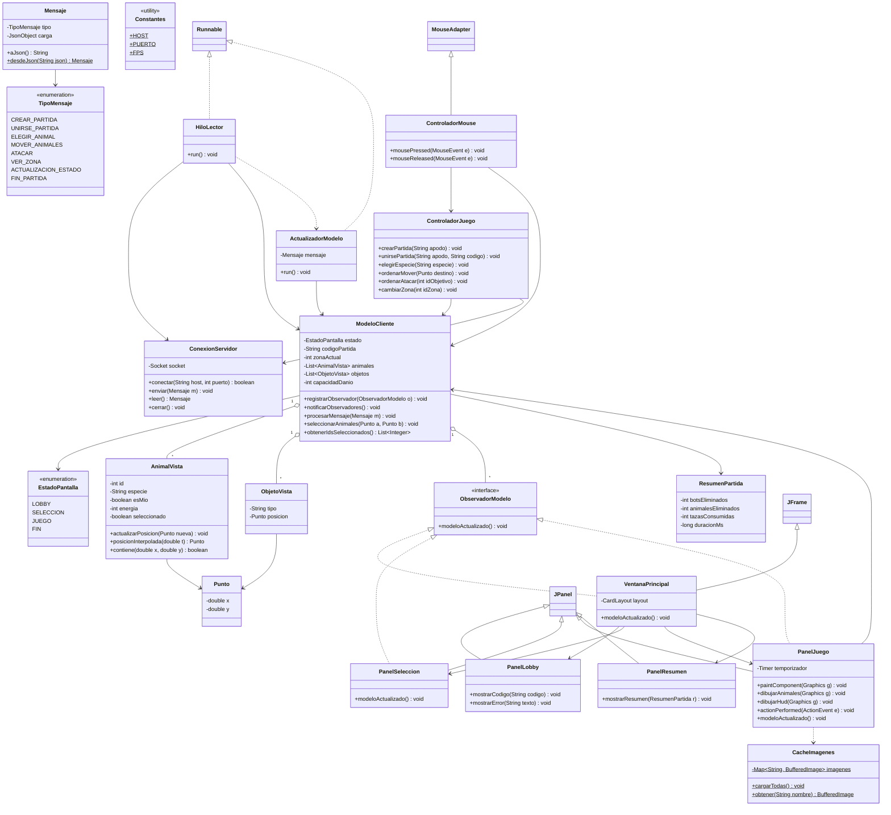

# Jungle Attack - Cliente - Especificación de Clases

## Paquete `util`

### Clase `Constantes`
Solo atributos `static final`, sin métodos.

**Atributos:**
- `HOST: String`
- `PUERTO: int`
- `FPS: int` — 30
- `ANCHO_VENTANA: int`, `ALTO_VENTANA: int`
- `RADIO_SELECCION: double`
- `ALTO_BARRA_ENERGIA: int`
- `RUTA_IMAGENES: String`

---

## Paquete `red`

### Enum `TipoMensaje`
- `CREAR_PARTIDA`, `UNIRSE_PARTIDA`, `ELEGIR_ANIMAL`, `MOVER_ANIMALES`, `ATACAR`, `VER_ZONA`
- `PARTIDA_CREADA`, `PARTIDA_UNIDA`, `ERROR`, `SELECCION_ANIMALES`, `PARTIDA_INICIADA`, `ACTUALIZACION_ESTADO`, `FIN_PARTIDA`

### Clase `Mensaje`
**Atributos:**
- `tipo: TipoMensaje`
- `carga: JsonObject`

**Métodos:**
- `aJson(): String`
- `desdeJson(String json): Mensaje` — estático

### Clase `ConexionServidor`
**Atributos:**
- `socket: Socket`
- `entrada: BufferedReader`
- `salida: PrintWriter`

**Métodos:**
- `conectar(String host, int puerto): boolean`
- `enviar(Mensaje m): void`
- `leer(): Mensaje` — null si se cerró la conexión
- `cerrar(): void`

### Clase `HiloLector` (implementa `Runnable`)
**Atributos:**
- `conexion: ConexionServidor`
- `modelo: ModeloCliente`

**Métodos:**
- `run(): void` — lee mensajes y crea un `ActualizadorModelo` por cada uno

### Clase `ActualizadorModelo` (implementa `Runnable`)
Se entrega a `SwingUtilities.invokeLater` para no tocar Swing desde el hilo de red.

**Atributos:**
- `modelo: ModeloCliente`
- `mensaje: Mensaje`

**Métodos:**
- `run(): void` — llama `modelo.procesarMensaje(mensaje)`

---

## Paquete `modelo`

### Enum `EstadoPantalla`
- `LOBBY`
- `SELECCION`
- `JUEGO`
- `FIN`

### Clase `Punto`
**Atributos:**
- `x: double`
- `y: double`

**Métodos:**
- `getX(): double`, `getY(): double`

### Clase `AnimalVista`
**Atributos:**
- `id: int`
- `especie: String`
- `esMio: boolean`
- `esBot: boolean`
- `energia: int`
- `seleccionado: boolean`
- `posicionAnterior: Punto`
- `posicionActual: Punto`

**Métodos:**
- `actualizarPosicion(Punto nueva): void`
- `posicionInterpolada(double t): Punto` — suaviza el movimiento entre dos snapshots
- `contiene(double x, double y): boolean`

### Clase `ObjetoVista`
**Atributos:**
- `tipo: String` — taza o bandera
- `posicion: Punto`

### Clase `ResumenPartida`
**Atributos:**
- `botsEliminados: int`
- `animalesEliminados: int`
- `tazasConsumidas: int`
- `duracionMs: long`
- `ganador: String`

### Interfaz `ObservadorModelo`
**Métodos:**
- `modeloActualizado(): void`

### Clase `ModeloCliente` (sujeto del patrón Observer)
**Atributos:**
- `apodo: String`
- `codigoPartida: String`
- `estado: EstadoPantalla`
- `mensajeError: String`
- `especiesDisponibles: List<String>`
- `miEspecie: String`
- `zonaActual: int`
- `zonasConAnimales: List<Integer>`
- `animales: List<AnimalVista>`
- `objetos: List<ObjetoVista>`
- `capacidadDanio: int`
- `tazasConsumidas: int`
- `botsEliminados: int`
- `resumen: ResumenPartida`
- `observadores: List<ObservadorModelo>`

**Métodos:**
- `registrarObservador(ObservadorModelo o): void`
- `notificarObservadores(): void`
- `procesarMensaje(Mensaje m): void`
- `seleccionarAnimales(Punto esquina1, Punto esquina2): void`
- `limpiarSeleccion(): void`
- `obtenerIdsSeleccionados(): List<Integer>`
- `buscarAnimalEn(double x, double y): AnimalVista`

---

## Paquete `controlador`

### Clase `ControladorJuego`
**Atributos:**
- `modelo: ModeloCliente`
- `conexion: ConexionServidor`

**Métodos:**
- `crearPartida(String apodo): void`
- `unirsePartida(String apodo, String codigo): void`
- `elegirEspecie(String especie): void`
- `ordenarMover(Punto destino): void`
- `ordenarAtacar(int idObjetivo): void`
- `cambiarZona(int idZona): void`

### Clase `ControladorMouse` (extiende `MouseAdapter`)
**Atributos:**
- `controlador: ControladorJuego`
- `modelo: ModeloCliente`
- `puntoInicio: Punto`

**Métodos:**
- `mousePressed(MouseEvent e): void`
- `mouseReleased(MouseEvent e): void` — arrastre = seleccionar; clic izquierdo = mover; clic sobre enemigo = atacar

---

## Paquete `vista`

### Clase `CacheImagenes`
**Atributos:**
- `imagenes: Map<String, BufferedImage>` — estático

**Métodos (estáticos):**
- `cargarTodas(): void` — rasteriza los SVG una sola vez al inicio
- `obtener(String nombre): BufferedImage`

### Clase `VentanaPrincipal` (extiende `JFrame`, implementa `ObservadorModelo`)
**Atributos:**
- `modelo: ModeloCliente`
- `layout: CardLayout`
- `panelLobby: PanelLobby`
- `panelSeleccion: PanelSeleccion`
- `panelJuego: PanelJuego`
- `panelResumen: PanelResumen`

**Métodos:**
- `modeloActualizado(): void` — cambia de panel según `modelo.estado`

### Clase `PanelLobby` (extiende `JPanel`)
**Atributos:**
- `campoApodo: JTextField`
- `campoCodigo: JTextField`
- `botonCrear: JButton`
- `botonUnirse: JButton`
- `etiquetaMensaje: JLabel`

**Métodos:**
- `mostrarCodigo(String codigo): void`
- `mostrarError(String texto): void`

### Clase `PanelSeleccion` (extiende `JPanel`, implementa `ObservadorModelo`)
**Métodos:**
- `modeloActualizado(): void` — habilita solo las especies libres
- `crearBotonesEspecies(): void`

### Clase `PanelJuego` (extiende `JPanel`, implementa `ObservadorModelo`, `ActionListener`)
**Atributos:**
- `modelo: ModeloCliente`
- `temporizador: javax.swing.Timer`
- `tiempoUltimoSnapshot: long`

**Métodos:**
- `paintComponent(Graphics g): void`
- `dibujarMapa(Graphics g): void`
- `dibujarAnimales(Graphics g): void`
- `dibujarBarraEnergia(Graphics g, AnimalVista a): void`
- `dibujarSeleccion(Graphics g): void`
- `dibujarHud(Graphics g): void` — daño, tazas, bots eliminados
- `dibujarBotonesZona(Graphics g): void`
- `actionPerformed(ActionEvent e): void` — cada tick llama `repaint()`
- `modeloActualizado(): void`

### Clase `PanelResumen` (extiende `JPanel`)
**Métodos:**
- `mostrarResumen(ResumenPartida r): void`

---

## Resumen de diseño

| Aspecto | Detalle |
|---|---|
| Static | `Constantes`, `Mensaje.desdeJson`, `CacheImagenes.cargarTodas/obtener` |
| Herencia | `VentanaPrincipal` extiende `JFrame`; paneles extienden `JPanel`; `ControladorMouse` extiende `MouseAdapter` |
| Interfaces | `ObservadorModelo`, `Runnable`, `ActionListener` |
| Polimorfismo | `ModeloCliente` notifica a cualquier `ObservadorModelo` sin saber cuál es |
| Patrones | Observer (`ModeloCliente` / `ObservadorModelo`), MVC (modelo, vista, controlador) |
| Hilos | `HiloLector` lee del socket; la UI solo se toca desde `ActualizadorModelo` con `invokeLater` |
| Errores | Sin excepciones para el flujo: el servidor manda `ERROR` y el modelo guarda `mensajeError` |

---

## Diagrama UML

